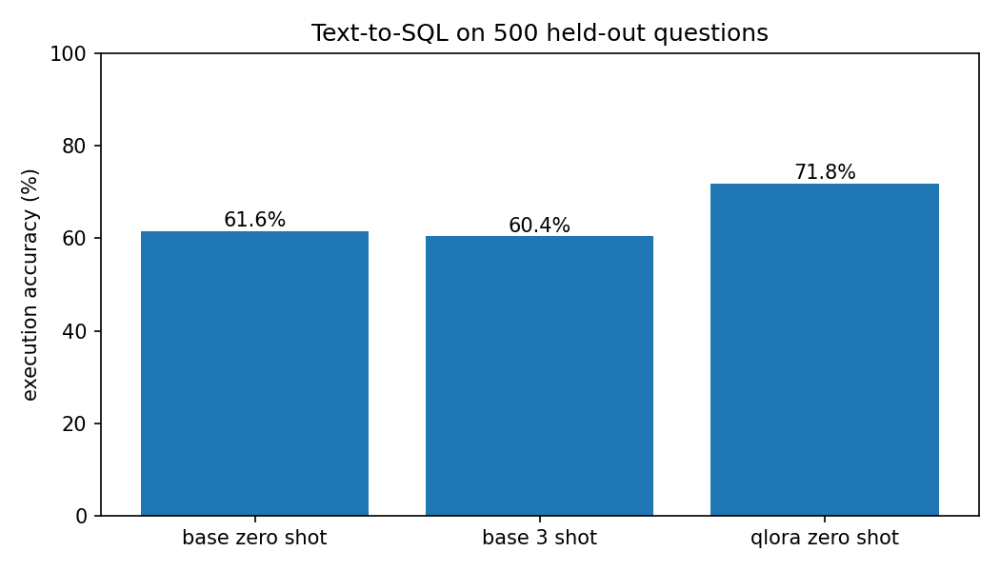
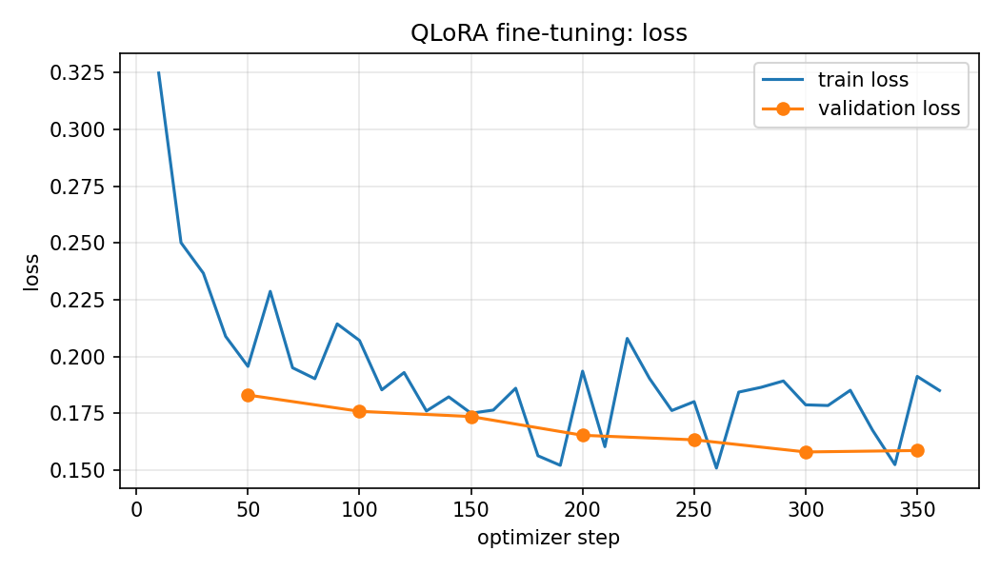

# Text-to-SQL with QLoRA (Qwen2.5-1.5B-Instruct)

Fine-tuning a small open model to turn questions into SQLite queries, measured by **execution accuracy**:
does the predicted query return the same rows as the reference query?

**Result:** one epoch of QLoRA on 5,820 examples (2 h 18 min on one Kaggle T4) raised execution accuracy on
500 held-out questions from **61.6 % to 71.8 %** (+10.2 points). Showing the base model three examples in the
prompt did not help (60.4 %).



## Results

500 test questions, greedy decoding, same base weights in all three runs. Raw numbers: [`results/metrics.json`](results/metrics.json).

| | Base, zero-shot | Base, 3-shot | **QLoRA, zero-shot** |
|---|---|---|---|
| Execution accuracy | 61.6 % | 60.4 % | **71.8 %** |
| Exact string match | 19.6 % | 21.8 % | **36.0 %** |
| Query runs without error | 90.0 % | 88.6 % | **96.8 %** |
| Latency per question, median / p95 (single request, T4, 4-bit) | 2.9 / 5.9 s | 3.3 / 6.6 s | 3.4 / 7.5 s |

Execution accuracy by query type (labels from the dataset):

| Query type | n | Base, zero-shot | Base, 3-shot | QLoRA |
|---|---|---|---|---|
| basic SQL | 289 | 76.1 % | 73.0 % | **83.4 %** |
| aggregation | 99 | 45.5 % | 44.4 % | **56.6 %** |
| single join | 58 | 50.0 % | 48.3 % | **69.0 %** |
| subqueries | 19 | 47.4 % | 52.6 % | **57.9 %** |
| window functions | 18 | 5.6 % | **16.7 %** | 11.1 % |
| multiple joins | 13 | 23.1 % | 38.5 % | **53.8 %** |
| set operations | 4 | 25.0 % | 25.0 % | 50.0 % |

Question by question, fine-tuning fixed 72 questions the base model got wrong and broke 21 that it got right.
Every prediction is in `results/predictions_*.jsonl`.

What fine-tuning changed, seen in the predictions:

- **It stopped inventing.** Asked for the number of virtual tours "in India and Argentina", the base model
  filtered on `type = 'virtual'`; the tuned model wrote `WHERE location IN ('India', 'Argentina')`.
  The base model also misspelled a column (`flackland_capacity` for `landfill_capacity`).
- **It writes SQLite, not MySQL.** The base model used `YEAR(date)` and `MONTH(date)`, which SQLite does not
  have; the tuned model compares date strings.
- **It does not add conditions nobody asked for**, such as `project_name LIKE '%Innovation%'`.

## Training



| Setting | Value |
|---|---|
| Base model | `Qwen/Qwen2.5-1.5B-Instruct`, loaded in 4-bit NF4 |
| Adapter | LoRA r=16 on all linear layers, 18.5 M trainable parameters |
| Data | 5,820 train / 180 validation / 500 test |
| Schedule | 1 epoch (≈360 optimizer steps), learning rate 2e-4, effective batch 16, max length 1,024 tokens, loss on the answer only |
| Hardware and time | one Tesla T4 (Kaggle), 137.6 min |

Validation loss fell from 0.183 (step 50) to 0.158 (step 300) and had levelled off by the end (0.159 at step
350). Full log: [`results/train_log.json`](results/train_log.json).

## Data

[`gretelai/synthetic_text_to_sql`](https://huggingface.co/datasets/gretelai/synthetic_text_to_sql) (Apache-2.0).
`src/data.py` samples from its train and test splits with a fixed seed and keeps only questions whose reference
query runs in SQLite and returns rows, so every test question can be scored by execution. The prepared files are
in `data/`.

## Limits

- The dataset is synthetic and each question comes with a small schema of a few tables. These numbers say
  nothing about large real-world schemas or benchmarks such as Spider or BIRD, which were not run.
- One training run, one seed. The overall gain (72 questions fixed against 21 broken) is far larger than
  chance; the small categories (4 set-operation questions, 13 multiple-join questions) are not reliable.
- Execution accuracy compares result rows. A wrong query can return the right rows by chance on a tiny table.
- Window functions stayed weak (11 %): 18 test questions, and few training examples of that kind.
- Latency was measured with the 4-bit model through Hugging Face `generate` on a T4, one request at a time.
  A serving engine such as vLLM would be much faster; that was not tested.
- The adapter weights (96 MB) are not in this repository.

## Reproduce

```bash
python -m venv .venv && source .venv/bin/activate
pip install -r requirements.txt
python -m pytest -q tests            # SQLite execution checker
python -m src.data                   # rebuild data/ (optional, already committed)
```

Training needs a GPU. On Kaggle (free T4), with a Kaggle API token set up:

```bash
KAGGLE_USER=<your Kaggle username> kaggle/push.sh
```

This uploads the code and data as a private Kaggle dataset and starts `kaggle/run.py`, which installs pinned
libraries, runs the tests, then `src.train`, `src.evaluate` and `src.plot`. Outputs land in
`/kaggle/working/outputs`.

## Licence

MIT. See `LICENSE`.
